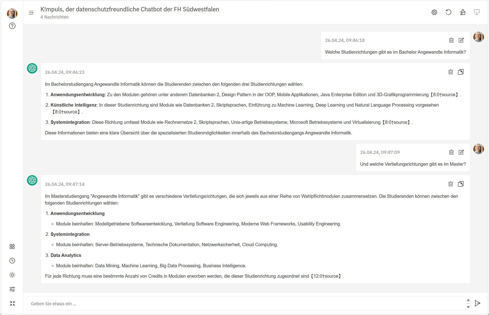

# OpenAI-UI – A simple UI for OpenAI's Chat API

This is a simple UI for OpenAI's chat (and assistant) API. It is designed to be used either directly with the API or through a [proxy server](htts://github.com/fhswf/openai-proxy) that can be used to manage the API key and provide a privacy-friendly way to use the API. 

This project is based on 
[ninasaul/chat-gpt-ui](https://github.com/ninasaul/chat-gpt-ui.git).

## Features

- Chat with OpenAI's [Responses API](https://platform.openai.com/docs/api-reference/responses)
- Access via a proxy server for privacy.
- Single Sign-On (SSO) via OpenID Connect (OIDC) for authentication.
- Markdown support for chat messages.
- Search document collections and cite the matching passages with in-chat Markdown links ([citation design](docs/local-file-search-citations.md)).
- Code editor for chat messages.
- Create custom GPT profiles with personal system prompts, a purpose, and an action title, then select one when sharing a web page or supported document with the installed K!mpuls app.

## Zero-knowledge chat persistence

Encrypted cross-device chat storage is opt-in from **Settings → General**. The
browser encrypts chats before syncing them through the `/api/zk` vault API; a
passkey with WebAuthn PRF support is required. The proxy backend must implement
the API contract described in [docs/zero-knowledge-chat.md](docs/zero-knowledge-chat.md).
